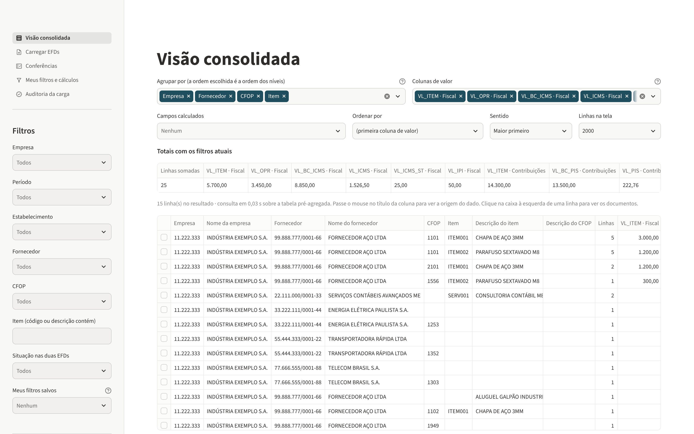

# Consolidador EFD — EFD Fiscal (ICMS/IPI) × EFD-Contribuições

Aplicação local em Python que carrega os `.txt` da **EFD ICMS/IPI** e da
**EFD-Contribuições**, cruza as duas escriturações e mostra, em uma tabela com
filtros, os valores de **entradas** consolidados por empresa, fornecedor, CFOP
e item (ou por qualquer outra combinação de níveis), com acesso ao documento.

O relatório é o que está nas EFDs: a ferramenta não aplica regra de crédito e
não simula tributo. Cada coluna leva o nome do campo e o registro de origem,
por exemplo `VL_ICMS (Reg. C170/C190/C590/D190/D590 · EFD Fiscal)`.



## Como usar

### Windows, sem instalar nada (recomendado)

1. Baixe `ConsolidadorEFD-windows.zip` na página de
   [Releases do repositório](https://github.com/Gbarao/Portifolio/releases/tag/consolidador-efd-windows).
2. Extraia o zip numa pasta comum (por exemplo, Documentos). Não abra direto
   de dentro do zip.
3. Dê duplo clique em `ConsolidadorEFD.exe`. Uma janela preta se abre e, em
   seguida, o navegador mostra o programa. Mantenha a janela preta aberta
   enquanto usa; para encerrar, feche-a.

O executável é gerado e testado automaticamente no Windows a cada alteração
(fluxo `.github/workflows/consolidador-efd-windows.yml`).

### Com Python instalado

```bash
pip install -r requirements.txt
python iniciar.py            # no Windows também serve o duplo clique em iniciar.bat
```

Em qualquer dos dois casos, tudo roda neste computador, no endereço
`localhost`. Nenhum dado sai da máquina.

### Onde os dados ficam

A base fica em `Documentos/Consolidador EFD` e é gravada em disco a cada
carga. Fechar o programa ou desligar o computador não apaga nada: ao abrir de
novo, as escriturações, os filtros salvos e a última visão (empresa,
agrupamento, colunas, filtros e busca) continuam lá. Os `.txt` podem ser
movidos ou apagados depois da carga, porque o conteúdo usado, inclusive o
texto original das linhas, fica na base. A página **Carregar EFDs** tem
**backup** (copiar a base para outra pasta, pen drive ou nuvem) e
**restauração**.

### Páginas

1. **Carregar EFDs**: selecione os arquivos (ou uma pasta). O tipo de cada um
   é reconhecido pelo registro 0000. A tela mostra o que será feito com cada
   arquivo antes de carregar.
2. **Visão consolidada**: escolha no topo a **empresa** (matriz e filiais) ou
   **estabelecimentos**, por CNPJ ou nome. Depois escolha os níveis em
   "Agrupar por", as colunas de valor e os filtros. Sobre a tabela pronta há
   **busca** e **filtros por coluna** (como o filtro do Excel), e os totais
   acompanham. Clique numa linha para ver os documentos; clique num
   documento para ver as linhas do TXT. Visões podem ser **salvas com nome**.
3. **Conferências**: selecionar um problema abre um **pop-up com as linhas do
   TXT** da EFD Contribuições e da EFD Fiscal lado a lado, com as linhas
   divergentes em vermelho e a comparação campo a campo.
4. **Meus filtros e cálculos**: filtros com nome e campos calculados.
5. **Auditoria da carga**: verificações de integridade e o que foi lido de
   cada arquivo.

## O que entra

Somente entradas.

| Escrituração | Registros lidos | Como entram |
|---|---|---|
| EFD Fiscal | C100 + C170 | Uma linha por item |
| EFD Fiscal | C100 sem C170 (C190) | Uma linha por CST/CFOP/alíquota |
| EFD Fiscal | C500 + C590, D100 + D190, D500 + D590 | Uma linha por registro analítico |
| EFD Contribuições | C100 + C170, A100 + A170, F100 | Uma linha por item |
| EFD Contribuições | C500 (C501 + C505), D100 (D101 + D105), D500 (D501 + D505), C190 (C191 + C195) | Uma linha por par PIS/COFINS |

Regras de escopo:

- `IND_OPER = 0`. O C500 da EFD-Contribuições não tem esse campo e só existe
  para aquisições; no C191/C195 entram os CFOPs iniciados por 1, 2 ou 3; no
  F100 entra `IND_OPER = 0`.
- Documentos com `COD_SIT` 02, 03, 04 ou 05 (cancelados, denegados,
  inutilizados) são contados e deixados de fora.
- O `VL_ISS` do A100 é do documento; ele é distribuído entre os A170 na
  proporção do `VL_ITEM`, em centavos inteiros, e a soma dos itens é
  exatamente o valor do documento.

Registros com possíveis valores de entrada ou de crédito que esta versão não
consolida (por exemplo C395/C396, F120, F130, F150, G125 e D700) são contados
e apontados na página de auditoria quando existem no arquivo.

## Como as duas EFDs são cruzadas

- **Empresa**: raiz do CNPJ (a EFD-Contribuições é da empresa; a EFD Fiscal é
  de cada estabelecimento).
- **Fornecedor**: CNPJ/CPF do registro 0150. O `COD_PART` é um código interno
  de cada arquivo e não é usado para comparar.
- **Documento**: chave eletrônica de 44 dígitos; sem chave, o conjunto
  estabelecimento, modelo, série, número, data e participante.
- **Visão consolidada**: as linhas das duas escriturações são empilhadas e
  cada coluna de valor é somada com um filtro por fonte. Assim, valores da
  Fiscal e da Contribuições aparecem lado a lado no mesmo grupo, e o mesmo
  tributo nunca é somado das duas fontes.
- **CFOP conciliado**: os registros de energia, frete e comunicação da
  EFD-Contribuições não têm CFOP. O nível "CFOP conciliado" usa o CFOP do
  mesmo documento na EFD Fiscal, quando ele é único. O nível "CFOP" mostra só
  o que está no registro.

## Garantias contra duplicidade

1. **Arquivo**: o mesmo conteúdo não entra duas vezes, ainda que com outro
   nome, outra codificação ou outra quebra de linha.
2. **Versão**: uma escrituração por empresa/IE, tipo e período. Original e
   retificadora juntas: fica a retificadora. Dois arquivos do mesmo tipo para
   o mesmo período: os novos são bloqueados, porque o arquivo não informa qual
   é o mais recente.
3. **Carga**: cada arquivo entra em uma transação. A quantidade de linhas e a
   soma de cada coluna de valor gravadas no banco têm de ser iguais às
   calculadas na leitura; qualquer diferença desfaz a carga daquele arquivo.
4. **Documento**: o mesmo documento escriturado mais de uma vez na mesma EFD
   (por exemplo, em dois períodos) conta uma vez. As outras ocorrências ficam
   listadas em Conferências e fora dos totais.
5. **Consulta**: não há junção entre as tabelas de fatos. As junções
   auxiliares usam tabelas de chave única e a contagem de linhas é conferida a
   cada carga.

O que a ferramenta **não** decide: registros sem identificação de documento
(F100 e a consolidação C191/C195) que aparecem idênticos no mesmo arquivo. O
arquivo não permite saber se é repetição ou dois lançamentos iguais; eles são
listados em Conferências e continuam nos totais.

Os valores são guardados como decimais exatos (centavos inteiros na leitura,
`DECIMAL(18,2)` no banco). Não há soma em ponto flutuante.

## Leiautes conferidos com os Guias Práticos

Os leiautes de todos os registros que o programa lê foram conferidos campo a
campo com o **Guia Prático EFD-ICMS/IPI versão 3.2.4** (30/07/2026) e o **Guia
Prático da EFD Contribuições versão 1.35** (18/06/2021): 22 registros da Fiscal
e 40 da Contribuições, 608 campos e 382 posições de leitura. A lista extraída
dos guias está em `testes/leiautes_guias_praticos.json`, e o teste
`testes/test_leiautes.py` refaz a conferência a cada alteração.

Além disso, a cada carga a ferramenta confere o que leu contra o próprio
arquivo: contagem por registro × 9900, cabeçalho × detalhes, C190 × C170 e
formato de CFOP, datas e chaves. A página **Conferências** mostra o resultado.

A tabela de CFOP não vem embutida: carregue o arquivo oficial em **Carregar
EFDs > Tabelas de apoio**. Sem ela, o CFOP aparece só com o código.

## Versões anteriores e segurança

- **Base de versão anterior**: é atualizada sozinha ao abrir, sem perder dados.
  Escriturações carregadas antes não têm o texto original das linhas (usado no
  pop-up). A página de carga avisa e oferece **Atualizar agora**, que lê de
  novo os mesmos arquivos sem mudar os valores. Para levar ao executável a base
  criada pela versão em Python, use **Restaurar um backup** e escolha o arquivo
  `base/efd.duckdb` da versão anterior.
- **TI e segurança**: veja `SEGURANCA.md`.

## Desempenho

Medido em uma máquina de 4 núcleos, com um par sintético (uma EFD Fiscal e uma
EFD-Contribuições) de 3,6 milhões de linhas e 2,4 milhões de linhas de entrada:

| Etapa | Tempo |
|---|---|
| Identificar os arquivos (tipo, empresa, período, conteúdo repetido) | 2 s |
| Carga completa (leitura dos dois arquivos em paralelo, banco e conferências) | 44 s |
| Visão por empresa, fornecedor, CFOP e item | 0,2 s |
| Visão agrupada por documento (300 mil grupos) | 0,2 s |
| Filtro por valor da linha ou por número de documento | 0,1 s |
| Detalhe de um grupo | 0,05 s |

A leitura rende de 50 a 60 mil linhas por segundo por núcleo, com um processo
por arquivo, e acontece uma vez: depois disso os filtros consultam a base
(211 MB em disco neste teste). Os tempos na sua máquina serão outros.

## Testes

```bash
python testes/test_leiautes.py              # leiautes x Guias Práticos
python testes/test_consolidador.py          # 130 verificações de ponta a ponta
python testes/gerar_sinteticos.py pasta --docs 300000   # gera um par de volume
```

Os testes usam EFDs sintéticas com valores conhecidos e cobrem: totais por
fonte, repetição de documento entre períodos, retificadora, versões em
conflito, mesmo arquivo com outro nome ou codificação, carga desfeita por
diferença de 1 centavo no controle, pareamento, CFOP conciliado, filtros,
campos calculados e tentativas de injeção.

## Estrutura

```
app.py                 interface (Streamlit)
iniciar.py / .bat      abre a aplicação
efd/leitor.py          leitura das duas escriturações -> Parquet + totais de controle
efd/trabalhador.py     processo de leitura de um arquivo
efd/base.py            DuckDB: carga, regras de duplicidade, tabelas derivadas, verificações
efd/consulta.py        visão consolidada, filtros, campos calculados, exportação
efd/leiautes.py        colunas, rótulos de origem e registros tratados
efd/seletor.py         janela de seleção de arquivos (tkinter)
efd/comparacao.py      comparação campo a campo das linhas do TXT (pop-up)
consolidador_efd.py    ponto de entrada do executável
empacotar/             receita do PyInstaller
testes/                gerador de EFDs sintéticas e testes
```

> Ferramenta de apoio à análise. Não substitui a apuração oficial nem a
> avaliação de um profissional sobre o direito a crédito de cada operação.
