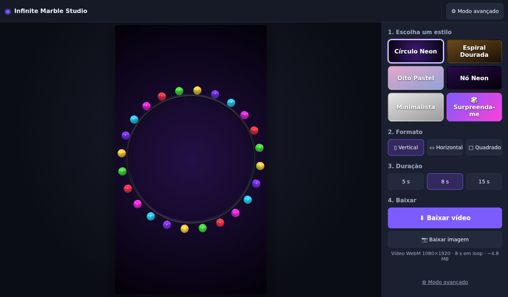
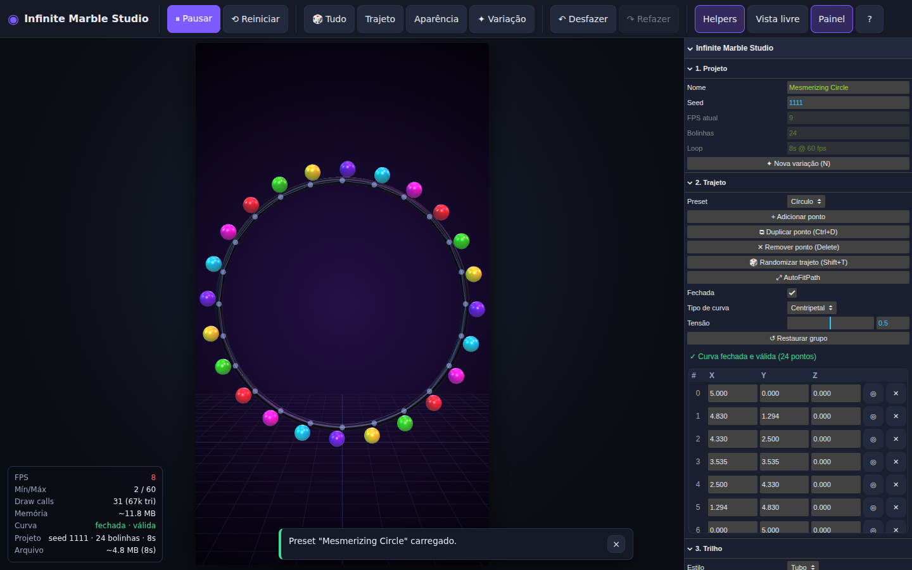
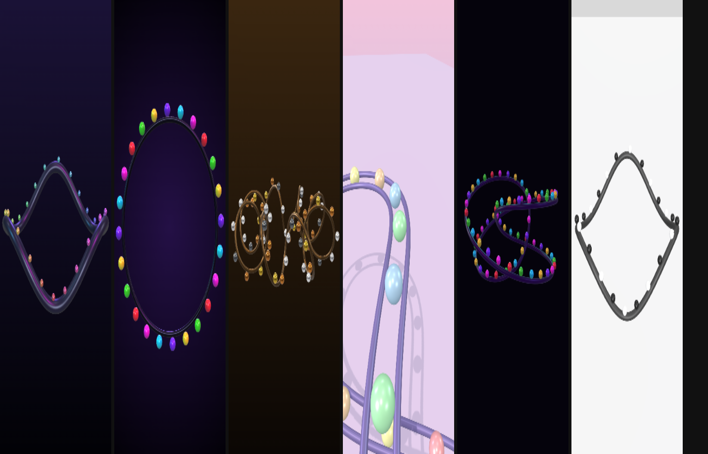

# Infinite Marble Studio

Aplicação web local para criar **animações 3D hipnóticas em loop perfeito**: bolinhas percorrendo
continuamente um trilho tridimensional editável, com exportação de vídeo vertical (9:16) pronta para
TikTok, Instagram Reels, YouTube Shorts e X.

- Sem backend, login, APIs pagas ou IA generativa. Funciona offline.
- Tudo é gerado por código: trajetos, trilhos, cores, fundo, iluminação e ambiente de reflexos.
- Movimento **determinístico e matemático**: mesma seed + mesmas configurações = mesmo resultado.
- Loop sem emenda: toda animação é função direta do tempo normalizado, com ciclos inteiros.

## Jeito mais fácil (sem instalar nada)

1. Baixe o arquivo [`release/InfiniteMarbleStudio.html`](release/InfiniteMarbleStudio.html)
   (no GitHub: abra o arquivo e clique em **Download raw file**).
2. Dê dois cliques nele. Ele abre no navegador; use **Chrome ou Edge**.
3. Escolha um **estilo**, o **formato** e a **duração** (5 s, 8 s, 15 s, 30 s ou 1 min) e clique
   em **⬇ Baixar vídeo**.

Ao trocar a duração, a velocidade das bolinhas é mantida: um vídeo de 1 minuto tem mais voltas, e
o fim continua emendando perfeitamente no começo. No modo avançado a duração vai até 5 minutos.

O vídeo vai para a pasta de downloads. Não é preciso Node.js, terminal nem internet.



O app abre no **modo simples**. O botão **⚙ Modo avançado** no topo mostra todos os controles
(editar o trajeto, câmera, luzes, presets, atalhos etc.), e a escolha fica salva no navegador.

Formato do vídeo: **WebM**. O YouTube aceita WebM. Para Instagram e X, que pedem MP4, converta o
arquivo antes de publicar (veja [Conversão opcional para MP4](#conversão-opcional-para-mp4-ffmpeg)).

## Modo avançado





_Capturas feitas em renderização por software (SwiftShader); em GPU real o FPS é muito maior._

## Sumário

- [Requisitos](#requisitos)
- [Instalação e comandos (desenvolvimento)](#instalação-e-comandos)
- [Como usar](#como-usar)
- [Atalhos de teclado](#atalhos-de-teclado)
- [Exportação](#exportação)
- [Presets e JSON](#presets-e-json)
- [Determinismo e loop perfeito](#determinismo-e-loop-perfeito)
- [Testes](#testes)
- [Troubleshooting](#troubleshooting)
- [Créditos](#créditos)

Documentação complementar: [GETTING_STARTED.md](GETTING_STARTED.md) (passo a passo),
[ARCHITECTURE.md](ARCHITECTURE.md) (decisões e fluxo) e [ROADMAP.md](ROADMAP.md).

## Requisitos

- Para **usar**: apenas o navegador (arquivo único, veja acima).
- Para **desenvolver**: Node.js **22.12 ou superior** (exigência do Vite 8 e do Vitest 5).
- Navegador desktop com **WebGL 2**: Chrome, Edge ou Firefox atualizados.
- Exportação WebM: `MediaRecorder` com WebM/VP8 (Chrome, Edge, Firefox). O encoder opcional
  **WebCodecs** requer `VideoEncoder` (disponível em Chrome e Edge). Sem nenhum dos dois, a
  aplicação exporta uma sequência PNG em ZIP.

## Instalação e comandos

```bash
cd infinite-marble-studio
npm install          # instala as dependências (versões exatas + package-lock.json)
npm run dev          # servidor de desenvolvimento em http://localhost:5173
npm run build        # checagem de tipos (tsc strict) + build otimizado em dist/
npm run build:single # gera release/InfiniteMarbleStudio.html (arquivo único, abre com dois cliques)
npm run preview      # serve a versão de dist/ em http://localhost:4173
npm test             # suíte Vitest
npm run test:coverage  # testes + cobertura (core/, path/, marbles/, camera/)
npm run lint         # ESLint sem warnings
npm run format       # Prettier
```

| Script          | O que faz                                                       |
| --------------- | --------------------------------------------------------------- |
| `dev`           | Vite com recarregamento automático                              |
| `build`         | `tsc --noEmit` (TypeScript strict) e `vite build`               |
| `preview`       | Serve o build de produção                                       |
| `typecheck`     | Apenas a checagem de tipos                                      |
| `test`          | `vitest run`                                                    |
| `test:watch`    | Vitest em modo observação                                       |
| `test:coverage` | Cobertura V8 com limite mínimo de 70% nos módulos críticos      |
| `lint`          | `eslint . --max-warnings=0` (inclui proibição de `Math.random`) |
| `format`        | `prettier --write .`                                            |
| `format:check`  | `prettier --check .`                                            |

## Como usar

1. **Escolha um ponto de partida**: seção _10. Presets_ → selecione um preset `★` e clique em
   _Carregar_, ou pressione `T` para uma cena aleatória.
2. **Edite o trajeto** (seção _2. Trajeto_):
   - troque o preset procedural (círculo, figura de oito, onda 3D, espiral toroidal, torus knot,
     pista em S, circuito empilhado ou percurso aleatório);
   - clique em uma esfera azul (handle) na cena e arraste as setas do gizmo para mover o ponto;
   - ou edite X/Y/Z diretamente na tabela; `◎` seleciona e `✕` exclui;
   - _Adicionar ponto_, `Ctrl+D` duplica e `Delete` remove o ponto selecionado.
   - O status mostra se a curva está **fechada e válida** (mínimo 4 pontos, sem duplicados).
3. **Ajuste trilho, bolinhas, câmera, iluminação e fundo** nas seções 3–7. Todos os campos
   numéricos aceitam digitação; passe o mouse para ver a dica de cada controle; cada seção tem
   _Restaurar grupo_.
4. **Loop** (seção 8): duração (1–300 s), FPS do preview (30/60) e _cycle count_.
5. **Exporte** (seção 9): escolha a resolução (9:16, 16:9, 1:1 ou custom até 4K), a duração, o
   FPS e clique em _Exportar vídeo_ (`Ctrl+E`) ou _Capturar PNG_.

Outras funções:

- **Vista livre** (`V`): câmera de edição independente; não altera a exportação.
- **Área segura**: sobreposição com 20% de margem em cada borda, só no preview.
- **Nova variação** (`N`): nova seed e mudanças reais em 3 a 5 categorias, com relatório.
- **Arrastar e soltar** um `.json` em qualquer lugar da janela carrega o preset.
- O projeto é salvo automaticamente como rascunho no `localStorage` e restaurado ao reabrir.

## Atalhos de teclado

| Tecla          | Ação                              |
| -------------- | --------------------------------- |
| `Space`        | Play/Pause                        |
| `R`            | Reiniciar                         |
| `T`            | Randomizar tudo                   |
| `Shift+T`      | Randomizar trajeto                |
| `Shift+A`      | Randomizar aparência              |
| `N`            | Nova variação (3+ categorias)     |
| `Ctrl+Z`       | Desfazer (até 50 passos)          |
| `Ctrl+Shift+Z` | Refazer (também `Ctrl+Y`)         |
| `Ctrl+S`       | Salvar preset                     |
| `Ctrl+E`       | Exportar vídeo                    |
| `H`            | Mostrar/Esconder helpers          |
| `G`            | Mostrar/Esconder GUI              |
| `V`            | Vista de edição livre             |
| `?`            | Mostrar atalhos                   |
| `Delete`       | Deletar ponto selecionado         |
| `Ctrl+D`       | Duplicar ponto selecionado        |
| `Esc`          | Desmarcar ponto / fechar diálogos |

No macOS, `Cmd` funciona no lugar de `Ctrl`.

## Exportação

### Vídeo WebM

Antes de gravar, um checklist bloqueia a exportação quando: a curva não é fechada ou é inválida;
`cycleCount` (bolinhas, loop ou câmera animada) não é inteiro positivo; a duração sai de 1–300 s;
a resolução passa de 4K, tem dimensão ímpar ou proporção fora de 1:4–4:1; `duração × fps` não é
inteiro; ou helpers/GUI não foram ocultados.

Durante a gravação a GUI, os helpers e a área segura são ocultados, o canvas passa para a
resolução final e o `LoopClock` entra em **modo Export** (cada frame vem do índice, nunca do
relógio). A sobreposição mostra barra de progresso, percentual, tempo decorrido/estimado, botão
_Cancelar_ e, ao final, _Re-gravar_.

Dois encoders (seção _9. Exportação → Encoder_):

| Encoder                    | Como funciona                                                                                                  | Quando usar                                                   |
| -------------------------- | -------------------------------------------------------------------------------------------------------------- | ------------------------------------------------------------- |
| **MediaRecorder** (padrão) | `canvas.captureStream(0)` + `requestFrame()`; VP8 (VP9 opcional). Grava em tempo real.                         | GPU capaz de renderizar a resolução final no FPS pedido       |
| **WebCodecs**              | `VideoEncoder` com timestamps exatos (`frame × 1e6 / fps`) + muxer WebM próprio. Mais rápido que o tempo real. | Máquinas mais lentas ou quando a precisão por frame é crítica |

O `MediaRecorder` carimba cada frame com o horário real de captura. Se a renderização não
acompanhar o tempo real, o vídeo pode ficar com timing irregular. Nesse caso a aplicação avisa e
sugere o encoder WebCodecs.

**Auto loop** (ligado por padrão) ajusta a duração do vídeo para um múltiplo inteiro da duração do
loop (ex.: loop de 8 s e vídeo pedido de 19 s → 16 s), garantindo repetição sem emenda.

Sem suporte a nenhum encoder, a exportação gera um **ZIP com a sequência PNG** (mais o
`preset.json` e um `LEIA-ME.txt` com o comando de conversão).

Nome do arquivo: `infinite-marble-{nome-do-projeto}-{seed}-{largura}x{altura}.webm`
(ou o nome definido em _Nome do arquivo_).

### PNG

_Capturar PNG_ renderiza o frame atual na resolução final (ex.: 1080×1920) sem GUI e sem helpers:
`infinite-marble-{nome-do-projeto}-{seed}-{largura}x{altura}.png`.

### Histórico

A subseção _Histórico_ guarda metadados das 10 últimas exportações no `localStorage` (miniatura,
nome, duração, resolução, data, seed, preset e o JSON completo do projeto). Os vídeos não são
armazenados. _Re-download_ baixa o arquivo se ele ainda estiver em memória. Caso contrário,
re-renderiza a exportação a partir do JSON salvo, e o resultado é o mesmo graças ao determinismo.

### Conversão opcional para MP4 (FFmpeg)

Não é necessária para usar a aplicação. Para gerar MP4 (H.264) compatível com qualquer player:

```bash
ffmpeg -i entrada.webm \
  -c:v libx264 \
  -pix_fmt yuv420p \
  -movflags +faststart \
  -preset slow \
  -crf 18 \
  saida.mp4
```

A partir do ZIP de PNGs (30 fps):

```bash
ffmpeg -framerate 30 -i frame_%05d.png -c:v libx264 -pix_fmt yuv420p -movflags +faststart -crf 18 saida.mp4
```

## Presets e JSON

- **Presets de cena built-in**: Mesmerizing Circle, Golden Spiral, Twisted Figure, Dark Loop e
  Minimalist (`src/presets/DefaultPresets.ts`).
- **Presets de iluminação**: Dark Neon, Clean Studio, Pastel, Metallic Gold e Wooden Warm.
- **Salvar/Carregar/Excluir** presets próprios (armazenados no navegador).
- **Exportar/Importar JSON**: o arquivo contém o schema versionado (`version: 1`) com todas as
  configurações: `output`, `loop`, `path` (pontos de controle), `track`, `marbles`, `camera`,
  `lighting` e `background`.
- A importação valida tipos, intervalos e campos obrigatórios e informa o caminho exato de cada erro
  (ex.: `marbles.count: valor 500 fora do intervalo [1, 250].`), com a opção de restaurar o padrão.
  Campos opcionais ausentes recebem o valor padrão. Presets sem `version` (formato v0) são
  migrados.

## Determinismo e loop perfeito

- Gerador **Mulberry32** com seeds derivadas por subsistema (`path`, `marbleColors`,
  `marbleScales`, `swayX`…). `Math.random` é proibido por regra de lint; a única fonte não
  determinística é a escolha de uma seed nova ao randomizar (`crypto.getRandomValues`).
- Tempo: `normalizedTime = frameIndex / totalFrames ∈ [0, 1)`. O frame `totalFrames` não é
  exportado (seria o frame 0 repetido).
- Posição: `u = modulo(direção × t × cycleCount + index / count + fase, 1)` e
  `curve.getPointAt(u)` (parametrização por comprimento de arco).
- Câmera, luzes, cores, pulsação e balanço usam apenas senos/cossenos completos, ciclos inteiros
  e ruído periódico com seed. Não há acumulação de delta time.
- O preview usa a mesma grade de frames do export, então um frame do preview e o mesmo frame do
  export são idênticos. O botão **Verificar determinismo** renderiza o mesmo frame pelos dois
  caminhos, na resolução final, e compara os pixels (tolerância de 2 níveis RGBA).

## Testes

```bash
npm test
npm run test:coverage
```

A suíte (Vitest, ambiente Node, sem WebGL) cobre: determinismo com seed, `LoopClock` (intervalo
`[0, 1)`, preview = export bit a bit), validação de trajetos, presets fechados e válidos, frames sem
inversão e contínuos no fechamento, loop perfeito (`t = 0` vs `t = 1 − ε`) para todos os modos de
câmera e presets, ausência de salto no último → primeiro frame, iluminação periódica, bolinhas
(fase, `InstancedMesh`, ausência de alocação por frame), serialização/migração/validação, checklist
de exportação, ZIP e muxer WebM.

## Troubleshooting

| Problema                                            | Solução                                                                                                                                                                |
| --------------------------------------------------- | ---------------------------------------------------------------------------------------------------------------------------------------------------------------------- |
| Tela com "Não foi possível iniciar"                 | O navegador não criou um contexto WebGL 2. Atualize o navegador e ative a aceleração de hardware (Chrome: `chrome://settings/system`).                                 |
| FPS baixo (indicador amarelo/vermelho)              | Desative sombras ou use resolução 512–1024, reduza bolinhas e segmentos do trilho, mantenha _Pixel ratio_ em 1× e desligue _Preview na resolução final_.               |
| Vídeo com velocidade irregular ou aviso de atraso   | A GPU não acompanhou o tempo real com o MediaRecorder. Use _Encoder → WebCodecs_, reduza a resolução/sombras ou exporte em 30 fps.                                     |
| Exportação pausou                                   | A aba ficou oculta. A gravação em tempo real pausa e retoma sozinha quando a aba volta a ficar visível.                                                                |
| Player não mostra a duração do WebM (MediaRecorder) | O MediaRecorder não grava a duração no arquivo. Use o encoder WebCodecs (grava a duração) ou converta com o comando FFmpeg acima.                                      |
| Exportação bloqueada                                | Leia a lista na sobreposição: curva aberta/inválida, ciclos não inteiros, resolução acima de 4K ou ímpar, `duração × fps` não inteiro.                                 |
| Download não aparece                                | Permita downloads automáticos para `localhost` nas configurações do navegador.                                                                                         |
| "Armazenamento local cheio"                         | Exclua presets salvos ou itens do histórico. O histórico remove miniaturas automaticamente quando falta espaço.                                                        |
| Preset JSON rejeitado                               | A mensagem indica o campo e o intervalo esperado. Corrija o arquivo ou use _Restaurar padrão_.                                                                         |
| Curva "inválida"                                    | Remova pontos duplicados consecutivos, mantenha pelo menos 4 pontos e use _AutoFitPath_ para recentralizar.                                                            |
| Bolinhas "flutuando" entre trilhos                  | No dual rail, se `raio da bolinha + raio do trilho` for menor que metade da largura, a bolinha fica centralizada entre os trilhos. Aumente o raio ou reduza a largura. |

## Créditos

- [three.js](https://threejs.org/) (MIT): renderização WebGL, `CatmullRomCurve3`, `TubeGeometry`,
  `InstancedMesh`, `OrbitControls`, `TransformControls` e `RoomEnvironment`.
- [lil-gui](https://lil-gui.georgealways.com/) (MIT): painel de controles.
- [Vite](https://vite.dev/), [Vitest](https://vitest.dev/), [TypeScript](https://www.typescriptlang.org/),
  [ESLint](https://eslint.org/) e [Prettier](https://prettier.io/).
- Todo o conteúdo visual (trajetos, cores, texturas, fundos e ambiente) é gerado proceduralmente
  pela aplicação. Nenhum modelo, textura ou música de terceiros é usado.
